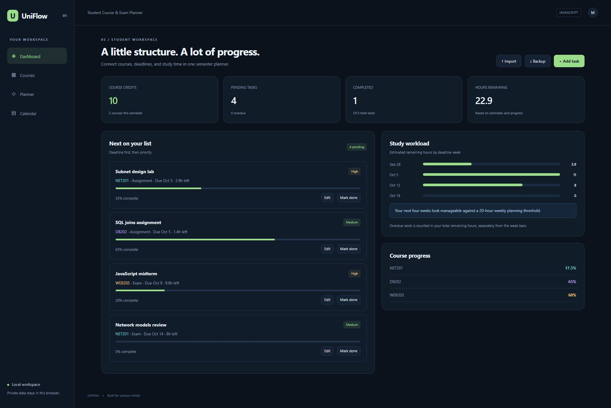

# UniFlow — Student Course & Exam Planner

برنامه‌ریزی درس، تمرین و امتحان با واحد، مهلت، اولویت، پیشرفت، تقویم و تحلیل بار کاری هفتگی.

A working portfolio project exploring student course & exam planner, built with JavaScript, HTML, CSS, and browser APIs.



## Features

- Course management with credit totals, assignments, exams, priorities, deadlines, and progress.
- Upcoming and overdue work, completion summaries, estimated remaining hours, and weekly workload analysis.
- Monthly deadline calendar, editable tasks/courses, local persistence, and validated JSON backup import/export.

## Run locally

Use **Node.js 22.13+**. Clone the repository, then run:

```sh
git clone https://github.com/MahtaRahmati/uniflow.git
cd uniflow
npm start
```

Open **http://127.0.0.1:4100**. The bundled sample provides a starting point; your own data can be entered or imported.

```sh
npm test
```

PORT can be changed through the environment. No dependency installation or build step is required.

## Project structure

- `public/` — responsive interface and browser-side domain logic
- `tests/` — meaningful domain checks
- `server.mjs` — small local static server
- `docs/` — screenshot and bilingual LinkedIn introduction

## Deployment

Serve the public/ folder through any static host. A GitHub Pages workflow is included. Enable **Settings → Pages → Source: GitHub Actions** to publish it. Expected URL after successful deployment: https://MahtaRahmati.github.io/uniflow/ .

## Scope & data handling

Device-local planner; no university integration, notifications, or cloud synchronization. Workload estimates use user-entered hours and task progress; they are planning estimates, not predictions.

All sample records and addresses are fictional. The interface works on desktop and mobile and includes keyboard focus states, labeled controls, and status/error feedback.

## Built with

Native ES modules, DOM APIs, and CSS. No framework or chart dependency.

## License

MIT.
